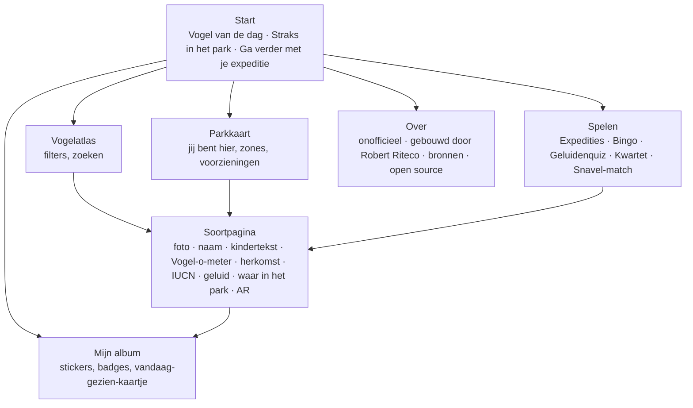
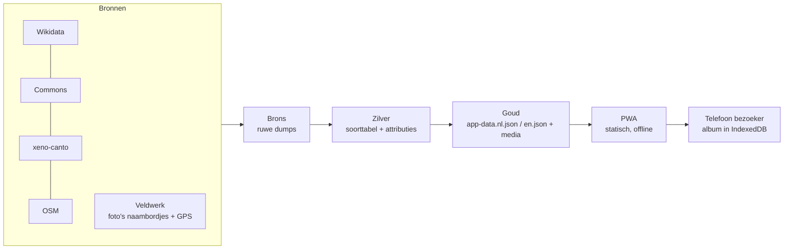
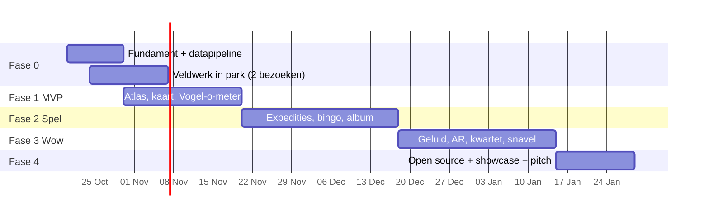

# Avifauna Ontdekker — plan voor een onofficiële bezoekers-webapp voor Vogelpark Avifauna

*Werktitel: **Avifauna Ontdekker** ("Vogelvinder" bestaat al). Versie 1.1 — 17 oktober 2026. Auteur: Robert Riteco, hobbyproject.*

> **Status: onofficieel.** Niet gemaakt door, in opdracht van of in samenwerking met Stichting Avifauna. Gebouwd met alleen openbare data en eigen waarnemingen. Doel: het later aanbieden aan Stichting Avifauna en overdragen, en het open source maken zodat andere parken het kunnen gebruiken.

Bijbehorende bestanden in deze map:
- `PITCH-IDEEEN.md`: ideeën die alleen samen met Avifauna kunnen, en de opzet van de pitch.
- `CLAUDE.md`: instructies voor de bouwsessies in Claude Code.
- `VELDWERK.md`: wat je bij een parkbezoek vastlegt en hoe je het aanlevert (ook als afvinklijst-artifact "Veldwerk Avifauna").

---

## 1. In één alinea

Een webapp (geen download, werkt ook zonder internet in het park) die van een bezoek aan Avifauna een **ontdekkingstocht** maakt. De kern is een **Vogelatlas** waarin je elke soort in het park kunt bekijken. Daaromheen zitten:
- een **getekende parkkaart** met "jij bent hier";
- **expedities met locatie-opdrachten** (zoals Blijdorp, maar dan zonder app-download en zonder account);
- **vogelbingo**;
- een **verzamelalbum** dat alleen op je eigen telefoon blijft;
- een **geluidenquiz**;
- de **Vogel-o-meter**: hoe groot of zwaar is deze vogel vergeleken met dingen die je kent;
- **AR: zet een levensgrote vogel in je woonkamer**.

De app vraagt geen gegevens, maakt geen accounts aan en koppelt niet met systemen van Avifauna.

## 2. Waarom dit iets toevoegt naast avifauna.nl

avifauna.nl is gemaakt om **een bezoek te verkopen**: tickets, abonnement, openingstijden. Avifauna Ontdekker is gemaakt voor **tijdens en na** het bezoek. Ze zitten elkaar dus niet in de weg.

| avifauna.nl | Avifauna Ontdekker |
|---|---|
| Vóór het bezoek: plannen en kopen | Tijdens het bezoek: ontdekken, zoeken, spelen |
| 21 soortpagina's (van de ~200 diersoorten) | Elke soort in het park (doel: alle ~200) |
| Lezen | Doen: verzamelen, raden, vergelijken, luisteren |
| Geen reden om de site na het bezoek te openen | Album, badges en seizoensexpedities geven een reden om terug te komen |
| Plattegrond als PDF | Kaart met "jij bent hier" die offline werkt |

**Doelgroepen:**
- **Primair:** ouders met kinderen van 4–12 jaar.
- **Belangrijke subgroep:** abonnees die vaak komen (Alphenaren betalen €42 per jaar). Hun probleem is "weer hetzelfde rondje". Een album dat nog niet vol is en expedities die per seizoen wisselen lossen dat op.
- **Secundair:** volwassen vogelliefhebbers die meer diepgang willen (Latijnse naam, IUCN-status, herkomst, geluid).

## 3. Ontwerpprincipes (vast)

1. **Duidelijk onofficieel, met Avifauna in de naam.**
   - De naam bevat "Avifauna": het product is voor dit park en moet straks naar de stichting.
   - Daarom is de afzender extra duidelijk: een vaste balk bovenaan elke pagina, *"Onofficieel prototype · gemaakt als voorstel voor Stichting Avifauna"*.
   - In de app staat níet dat Avifauna het "verwacht te omarmen"; dat wekt de indruk van steun die er nog niet is.
   - Tot de pitch: `noindex` (niet vindbaar via Google) en op het eigen domein, bijv. `<eigen-domein>/avifauna`. Een eigen domein met "avifauna" erin pas na toestemming.
   - Geen Avifauna-logo, geen nagemaakte huisstijl, en geen teksten, foto's of plattegrond van avifauna.nl. Die zijn © Vogelpark Avifauna en er staat geen open licentie bij.
   - Elke pagina heeft onderaan: *"Onofficiële gids · niet verbonden aan Stichting Avifauna"*.
   - Een "Over"-pagina vermeldt: *gebouwd door Robert Riteco als hobbyproject*, met links naar zijn persoonlijke website en de open-source code.
   - Naar avifauna.nl wordt alleen **gelinkt** (tickets, dagprogramma, soortpagina's).
2. **Privacy door ontwerp.**
   - Geen accounts, geen login, geen cookies, geen tracking van personen.
   - Wat je verzamelt (album, badges, bingokaart) staat **alleen op je eigen telefoon**, in de browseropslag. Er gaat niets naar een server.
   - Geen camera-functies die beelden van kinderen maken of versturen. De spanwijdte-meter is daarom geschrapt.
   - De locatie (GPS) wordt alleen op het toestel gebruikt en nooit opgeslagen of verstuurd.
3. **Alleen openbare, herbruikbare data**, met bron en licentie bij elke foto en elk geluid (§7).
4. **Werkt offline in het park.** In de Tropenhal en op drukke dagen is het bereik slecht. De app laadt daarom bij de eerste keer openen alles wat nodig is.
5. **Kindvriendelijk én bruikbaar voor ouders.**
   - Grote tikvlakken, plaatjes eerst, een voorleesknop en weinig tekst.
   - Een peuterstand (2–4 jaar) met alleen plaatjes en geluid.
   - Ouders vinden meer diepgang onder "Meer weten".
6. **Herbruikbaar voor andere parken.** Alles wat specifiek is voor Avifauna (soortenlijst, kaart, opdrachten, kleuren, teksten) zit in één **parkpakket**, een map met databestanden. Een ander park vervangt die map en heeft dan zijn eigen app.
7. **Overdraagbaar.** Het is een statische site zonder server. Hosting kost €0 per maand, en Avifauna kan het later zelf overnemen zonder dat er systemen draaien die onderhoud vragen.

## 4. Wat anderen doen

| Park | Wat ze hebben | Techniek | Les voor ons |
|---|---|---|---|
| **Diergaarde Blijdorp**: "Expeditie Blijdorp" | Expedities (routes met stops, weetjes en opdrachten), opdrachten voor thuis, badges, levels. Levels geven toegang tot webcams, achter-de-schermen-artikelen, horecakorting, meet-the-keeper en fysieke pins (€4,50, alleen met de juiste badge). Ook kaart, voedertijden, account, abonnementscan en tickets. | Native app. Locatiecontrole alleen via GPS ("start alleen in het park", sinds v2.7, nov 2025). | Het spelmechanisme werkt: ~100k gebruikers in 14 weken (eigen claim van het park). Het vraagt wél een download en een account. Dat hoeft bij ons niet. |
| **Burgers' Zoo Map** (2021) | AR-pijlen in het camerabeeld voor de looprichting, vaste routes (o.a. "mis niets" en een toegankelijke route), route op maat langs gekozen soorten. | Native app met beacons + GPS + ARCore. | AR-navigatie heeft beacons in het park nodig. Dat kan niet onofficieel en niet als webapp. De routes kunnen wel. |
| **Artis** | GPS-route "Vergeten Dieren" met filmpjes, audiotour. | Native app. | Media per stop is sterk. Bron gedateerd. |
| **GaiaZOO** | Kaart, dierenzoeker, faciliteitenzoeker, meldingen voor voedertijden. | Native app, 3,1 sterren. | Basisfuncties alleen, zonder spel, levert gemiddelde waardering op. |
| **Zoo Zürich** | Kaart, show- en voedertijden, quiz die door beacons op locatie start, prijsvraag, 3 talen. | Native app. | Een quiz op locatie is een bewezen patroon. |
| **Taronga** | Beacon-weetjes op 20+ plekken, "Wild Squad Missions" voor kinderen, dagplanning met herinneringen. | Native app, 2,7 sterren (klacht: traag laden). | Traag laden doet de waardering de das om, dus offline-first is belangrijk. |
| **Mandai / Bird Paradise** | Routes, programma-herinneringen, waarschuwingen bij dierwaarnemingen, dagelijkse prijs-game, 360°-tour vooraf. | Native app + live data. | Live waarschuwingen hebben data van het park nodig; dat is iets voor de pitch. |

**Niet geverifieerd:** apps van Ouwehands, Amersfoort, Wildlands, Dierenrijk, Vogelpark Veldhoven en Weltvogelpark Walsrode; ZSL London; of welk park dan ook camera-soortherkenning of adopteer-een-dier in de app heeft. Avifauna heeft zover bekend **geen eigen app**; zelf nog checken in de App Store en Play Store.

**Conclusie:**
- Nederlandse dierentuin-apps zijn native, vragen een account en zijn sterk op verkoop gericht. Met een gemiddelde van 2,7–3,1 sterren valt er weinig te winnen met "nog een kaartapp".
- Ons onderscheid zit in vier dingen:
  - **geen download en geen account**;
  - **de beste soorteninformatie van het park**, rijker dan de eigen site;
  - **spel dat werkt zonder hardware in het park**;
  - **open source en herbruikbaar**. Dat heeft niemand.

## 5. Ideeën en haalbaarheid met vibecoden

Legenda bouwbaarheid: 🟢 goed te vibecoden (dagen) · 🟡 te doen, maar met lastige delen (weken) · 🔴 niet zinvol als onofficiële webapp.
Afhankelijkheid: **OD** = open data · **VW** = eigen veldwerk in het park · **AV** = alleen met Avifauna.

| # | Idee | Wat het is | Waarde | Bouw | Afh. | Fase |
|---|---|---|---|---|---|---|
| A | **Vogelatlas** | Alle soorten als kaarten. Filter op werelddeel, kleur, grootte, zone in het park en bedreigingsstatus. Per soort: foto, NL/EN/Latijnse naam, kindertekst, weetjes, herkomstkaart, IUCN-status, geluid, "waar in het park". | Hoog: de ruggengraat | 🟢 | OD+VW | 1 |
| B | **Parkkaart** | Eigen getekende kaart (SVG) met zones, verblijven, toiletten, eten, speeltuin, picknickplekken. Blauwe stip via GPS. | Hoog | 🟡 (de kaart tekenen kost tijd) | VW+OSM | 1 |
| C | **Vogel-o-meter** | Grootte en gewicht vergeleken met bekende dingen: "zo zwaar als 3 pakken melk", "zijn vleugels zijn breder dan papa lang is", met silhouet naast een kind of volwassene. Automatisch uit de Wikidata-feiten. | Hoog (wow, en goedkoop) | 🟢 | OD | 1 |
| D | **Expedities met locatie-opdrachten** | Thema-routes zoals "Roofvogels", "Kleurenjacht", "Vogels uit Afrika" en een herfstvakantie-expeditie. Elke stop heeft een opdracht: zoek, tel, kijk, beantwoord. Een stop opent pas als je GPS in de juiste **zone** van het park zit (nauwkeurigheid 5–20 m; geen verblijf-niveau). In de Tropenhal (binnen) werkt GPS slecht; daar is de opdracht zelf het bewijs ("hoeveel tenen zie je?"). | Hoog (Blijdorp-effect) | 🟡 | VW | 2 |
| E | **Vogelbingo** | Bingokaart van 3×3 of 4×4 die bij elk bezoek wisselt, met soorten en gedrag ("vogel op één poot"). | Hoog voor kinderen | 🟢 | VW | 2 |
| F | **Verzamelalbum en badges** | Stickeralbum: elke gevonden soort krijgt een sticker, plus badges voor expedities. Alleen lokaal opgeslagen. Export als **afbeelding** of **printbare pdf**, gemaakt op het toestel. Waarschuwing: wis je de browsergegevens, dan ben je het album kwijt. Daarom een knop "back-up als bestand". | Hoog voor abonnees | 🟢 | – | 2 |
| G | **"Vandaag gezien"-kaartje** | Aan het eind van het bezoek een mooi samenvattingskaartje (aantal soorten, favoriet, badge) om te bewaren of te delen. Gemaakt op het toestel; alleen de gebruiker deelt het. | Middel; levert gratis zichtbaarheid op | 🟢 | – | 2 |
| H | **Geluidenquiz "Wie roept daar?"** | Je hoort een geluid en kiest de vogel. Thuis en in het park. Alleen soorten met een eigen opname of een opname met open licentie (§7.5). Begin met ~20–40 soorten. | Middel-hoog | 🟢 (bouw) / 🟡 (opnames verzamelen) | VW+OD | 3 |
| I | **AR: vogel in je kamer** | Levensgroot 3D-model via `<model-viewer>`: Android met Scene Viewer, iOS met Quick Look (USDZ). Zet een helmkasuaris naast de bank. | Hoog (wow) | 🟡: losse 3D-modellen met open licentie zijn er maar voor een handvol soorten. Begin met 3–5 iconen. | OD | 3 |
| J | **Vogelkwartet / top-trumps** | Digitaal kwartet met echte stats (spanwijdte, gewicht, leeftijd, snelheid) plus een **printbare kaartset** als pdf. Werkt thuis, in de auto, op regendagen. | Hoog (blijft hangen) | 🟢 | OD | 3 |
| K | **Snavel-match / bouw-je-vogel** | Minigame: welke snavel past bij welk eten, welke poot bij welke plek. Daarna een eigen vogel samenstellen uit snavel, poten en vleugels, met uitleg waarom dat wel of niet werkt. | Middel-hoog (leerzaam) | 🟡 (tekenwerk) | OD | 3 |
| L | **Dagprogramma "straks"** | "Over 12 min: pinguïns voeren", met link naar avifauna.nl/dagprogramma. De tijden worden met de hand bijgehouden, met de melding "check altijd avifauna.nl". Herinneringen alleen zolang de app open is; echte pushmeldingen hebben een server nodig. | Middel | 🟢 (bouw) / onderhoud is het risico | publiek + handwerk | 2 |
| M | **Routes**: kinderwagen, regen, "mis niets", korte route met peuter | Vooraf berekende routes over het padennetwerk; een regenroute langs overdekte plekken. | Middel | 🟡 | VW | 2 |
| N | **Peuterstand en voorlezen** | Alleen plaatjes en geluid; voorlezen via de spraakfunctie van de browser. | Middel | 🟢 | – | 1 |
| O | **Taal NL/EN (later DE)** | Meertalige interface; de soortnamen komen uit Wikidata. | Middel (toeristen, hotelgasten) | 🟢 | OD | 1 |
| – | AR-navigatie zoals Burgers' | Pijlen in het camerabeeld | – | 🔴 heeft beacons nodig en iOS ondersteunt WebXR-AR niet | AV | pitch |
| – | Locatie via beacons, QR of NFC bij verblijven | Precieze triggers per verblijf | – | 🔴 onofficieel kun je niets ophangen | AV | pitch |
| – | Soortherkenning met de camera | Foto maken en de app zegt welke vogel het is | – | 🔴 de herkenning is onbetrouwbaar voor exoten in gevangenschap, en strijdig met principe 2 | – | geschrapt |
| – | Tickets, abonnement, live meldingen | – | – | 🔴 heeft koppelingen met systemen van het park nodig | AV | pitch |

**Advies voor de reikwijdte:** A, B, C, N en O vormen samen de MVP (fase 1). D, E, F, G, L en M maken het een product (fase 2). H, I, J en K zijn de wow-laag (fase 3). Liever 1 fase af en getest in het park dan 3 fases half.

## 6. Productopbouw



**Drie leesniveaus per soort** (keuze bovenaan; de app onthoudt hem):

| Niveau | Voor wie | Vorm | Voorbeeld (pinguïn) |
|---|---|---|---|
| **Kind** | 4–10 jaar, ook om voor te lezen | 3–4 korte zinnen, spreekt het kind aan, één verwonderfeit | "Deze pinguïn kan niet vliegen. Maar onder water vliegt hij bijna!" |
| **Iedereen (B1)** | Standaard voor volwassenen | 5–7 zinnen in B1-Nederlands: korte zinnen, gewone woorden | "De Humboldtpinguïn leeft aan de kust van Peru en Chili. Daar is het water koud en zit veel vis." |
| **Vogelkenner** | Liefhebbers | Vooral een **feitenblok uit de data**: orde/familie, IUCN-status en trend, verspreiding, gewicht, spanwijdte, broedduur, legsel, levensduur, links naar xeno-canto, Wikipedia en de Avifauna-pagina. Eén extra alinea alleen voor de top-50. | — |

Zo schrijf je in de praktijk twee teksten per soort, en komt het kennersniveau grotendeels automatisch uit de data. Drie volledige teksten per soort (~600 teksten om te controleren) gaat te ver.

**Voorbeeld van een soortpagina** (Humboldtpinguïn):
- **Kop:** grote foto (Commons, met bron), *Humboldtpinguïn · Spheniscus humboldti*, IUCN-badge "Kwetsbaar".
- **Vogel-o-meter:** "Zo groot als een kind van 3 · zo zwaar als 4 pakken melk", met silhouetten.
- **Tekst op het gekozen niveau** (kind / B1 / kenner), in eigen woorden op basis van feiten (zie §7.3), met voorleesknop.
- **Waar woont hij?** Wereldkaartje met Peru en Chili gemarkeerd, plus "11.000 km van Alphen".
- **Hoor hem:** geluidsknop, als er een opname met open licentie is.
- **Hier in het park:** zone op de kaart en de tijd van de eerstvolgende voedering.
- **Sticker:** knop "Gezien!" om de sticker in het album te zetten.
- **Meer weten** (voor ouders): gewicht, spanwijdte, leeftijd, dieet, link naar Wikipedia en naar de Avifauna-pagina als die er is.

## 7. Data: waar komt alles vandaan

### 7.1 De echte blokkade: de soortenlijst en waar ze staan

avifauna.nl heeft maar **21 soortpagina's**, terwijl het park "ongeveer 200 diersoorten" noemt. Ook staat nergens **waar** in het park een soort zit. Er bestaat geen openbare complete lijst; ZIMS/Species360 (de dierentuinadministratie) is niet openbaar.

**Oplossing: eigen veldwerk met foto's.** Robert fotografeert tijdens een bezoek elk naambordje, met locatie aan in de camera. Elke foto bewaart zelf de GPS-positie en het tijdstip. Een script haalt daarna:
- de soortnaam van het bordje (tekstherkenning, gecontroleerd door Claude en Robert);
- de positie uit de foto;
- de zone uit die positie, getoetst aan de kaart.

Binnen (Tropenhal, doorloopvolières) dienen foto's bij in- en uitgang als ankerpunt. Zie `VELDWERK.md`.

Soortnamen en "deze vogel zit in dat verblijf" zijn feiten, en feiten mag je vastleggen. Tekst en foto's van de bordjes neem je níet over; de foto's zijn alleen werkmateriaal en worden niet gepubliceerd. De veldwerkstand in de app is daarmee pas later nodig, voor controles.
- Resultaat: `species.csv` (wetenschappelijke naam, zone, verblijf-ID, datum gezien) en `places.geojson`.
- Risico: het park verandert. Daarom staat bij elke soort de datum waarop hij laatst gezien is, en de app meldt "laatst gecontroleerd: …".
- Bij de overdracht kan Avifauna deze lijst officieel bijhouden.

### 7.2 Openbare bronnen

| Bron | Gebruiken voor | Licentie | Hoe |
|---|---|---|---|
| **Wikidata** | Ruggengraat: namen (NL/EN), Latijnse naam, IUCN-status (P141), spanwijdte (P2050), gewicht (P2067), leeftijd (P2250), foto-verwijzing (P18), GBIF-ID (P846) | CC0, helemaal vrij | SPARQL, gekoppeld via de wetenschappelijke naam (P225). De dekking verschilt per soort; ontbrekende waarden vul je handmatig aan met een bronvermelding. |
| **Wikimedia Commons** | Foto's | Per foto anders | Alleen CC0, PD, CC BY of CC BY-SA. Maker en licentie vastleggen bij het bouwen. |
| **Wikipedia NL/EN** | Alleen als **"lees meer"-link** en als feitenbron | CC BY-SA 4.0 | Tekst niet overnemen (zie 7.3). |
| **xeno-canto** | Geluiden (aanvulling) | ~99% is NC of ND; maar een handvol per soort is BY-SA of CC0 | Zie §7.5. |
| **GBIF** | Herkomstkaartje (waar komt de soort in het wild voor) | Per dataset; tegels met bronvermelding | Waarnemingskaart, geen exact verspreidingsgebied. Alternatief: een simpel werelddeel- of landenkaartje uit Wikidata (P183 endemisch in / continent) met Natural Earth als basiskaart (publiek domein). Dat is eenvoudiger en mooier. |
| **IUCN Red List** | Alleen de **categorie** (via Wikidata) en een link | API alleen persoonlijk/niet-commercieel, niet doorgeven | API **niet** gebruiken. |
| **OpenStreetMap** | Basis voor de getekende kaart: paden, gebouwen, water | ODbL | Volgens Robert komt OSM goed overeen met de plattegrond van Avifauna; OSM is dus de basis. Ontbrekende details voeg je zelf toe in OSM, zodat ze open blijven. |
| **Plattegrond avifauna.nl** | Alleen als **visuele referentie** bij het natekenen (namen en ligging van gebieden) | © Avifauna | Niet overnemen of overtrekken. Na toestemming kan hun eigen kaart in de app. |
| **avifauna.nl** | Alleen **links**: tickets, dagprogramma, soortpagina's, plattegrond | © Avifauna | Niet kopiëren. De tijden van het dagprogramma zijn feiten en mag je dus overtypen, maar altijd met een link naar de bron. |
| **3D-modellen** (AR) | Een paar iconische soorten | Bijvoorbeeld Sketchfab CC BY. Kwaliteit en aanbod wisselen. | Per model controleren en de bron vermelden. Zelf laten maken kan later, als pitch-idee. |

### 7.3 Teksten: zelf schrijven in plaats van Wikipedia overnemen

Wikipedia-tekst is CC BY-SA: alles wat je ervan afleidt, moet onder dezelfde licentie, en de toon is niet voor kinderen. Het advies is daarom: **eigen teksten schrijven op basis van feiten**, op twee niveaus (kind en B1; het kennersniveau is vooral data) (Wikidata plus gecontroleerde bronnen), met een AI-concept en een menselijke controle. Bij elke tekst staan de bronnen.
- Voordeel: de teksten zijn kindvriendelijk, en de dataset kan onder een simpele licentie (CC BY 4.0).
- Nadeel: het kost controlewerk. Reken op ~200 soorten × 2 teksten × 2 minuten controle ≈ 13 uur. Dat is te verdelen over de fases: eerst de 50 bekendste soorten (≈ 3,5 uur).

### 7.4 Licenties in de repo

- **Code:** MIT.
- **Eigen data en teksten** (`species.csv`, kinderteksten, kaart-SVG): CC BY 4.0. De kaart wordt **ODbL** als die van OSM is afgeleid; dan houden we hem apart.
- **Media:** elk bestand houdt zijn eigen licentie. Per bestand een record met bron, URL, maker, SPDX-licentie, titel en ophaaldatum. Daaruit worden automatisch `ATTRIBUTIONS.md` en de bronnenpagina in de app gemaakt.
- **Nooit in de repo:** NC- of ND-materiaal (NC-geluid wordt pas bij het bouwen opgehaald), IUCN-data, content van avifauna.nl.

### 7.5 Vogelgeluiden: opties en advies

**Het probleem in één zin:** er zijn genoeg opnames, maar bijna allemaal mag je ze niet vrij hergebruiken.

Steekproef van 14 Avifauna-soorten op xeno-canto (de grootste open geluidenbank):
- Bij de oehoe staan 1.177 opnames. Daarvan is 88% "niet-commercieel" en 11% "niet bewerken"; slechts 10 zijn vrij te gebruiken.
- Alleen voor ongeveer 5 van de 14 soorten bestaat überhaupt een vrije opname, vaak maar 1 tot 3.
- Humboldtpinguïn, helmkasuaris, kroonduif, pelikaan en gier: niets vrij.

| Optie | Wat | Licentie | Dekking | Oordeel |
|---|---|---|---|---|
| **1. Eigen opnames in het park** | Zelf opnemen met telefoon + clipmicrofoon met windkap (~€20–30) | Van jou: vrijgeven als CC0 of CC BY | Alle soorten die geluid maken, met het echte geluid van díe vogel | ✅ **Hoofdroute.** Nadeel: kost bezoeken; vogels in gevangenschap roepen minder. Rond voedertijden gaat het het best. |
| **2. xeno-canto BY-SA / CC0** | Bouwscript met filter `lic:BY-SA` en `lic:PD` en kwaliteit ≥ C | Vrij, met naamsvermelding; BY-SA: bewerkte fragmenten onder dezelfde licentie | ~1/3 van de soorten, 1–3 opnames | ✅ **Aanvulling.** API-sleutel via een gratis account, nooit in de repo. |
| **3. Wikimedia Commons** | Audio per soort | Altijd vrij | Dun voor exoten; vaak kopieën van xeno-canto | ✅ Kleine aanvulling via hetzelfde script. |
| **4. Niet-commerciële xeno-canto-opnames** | Afspelen via de eigen speler van xeno-canto (online) of een link "luister op xeno-canto" | Mag gelinkt en ingesloten worden, niet in de repo of offline | Bijna alles | 🟡 **Alleen als link of online-speler op de soortpagina**, niet in de quiz en niet offline. Risico: als het park de app overneemt (het verkoopt tickets), is "niet-commercieel" een grijs gebied. |
| **5. Toestemming vragen** | De opnemer van een specifieke NC-opname mailen, of Avifauna's verzorgers laten opnemen (pitch-idee #9) | Wat je afspreekt | Gericht, voor de top-soorten | 🟡 Later, voor 5–10 iconen zonder eigen opname. |
| **6. Macaulay Library (Cornell)** | Grootste archief | Geen download; inbedden alleen niet-commercieel; anders betaalde licentie | Hoog | ❌ Niet geschikt. |
| **7. Freesound, Tierstimmenarchiv Berlin** | Kleinere archieven | Deels CC0/CC BY | Onbekend, waarschijnlijk dun | ⚪ Later checken. |

**Mag "niet-commercieel" (CC BY-NC-SA) wel? Ja, onder voorwaarden.** Geen juridisch advies; dit is de lezing van de Creative Commons-licentie.
- "Niet-commercieel" gaat over het **gebruik**, niet over wie je bent. Een gratis app zonder advertenties, zonder betaalde functies en zonder geld ervoor is niet-commercieel gebruik. Dat geldt dus nu.
- **Naamsvermelding (BY):** opnemer, XC-nummer, licentie met link, en "via xeno-canto.org". Op de soortpagina en op de bronnenpagina.
- **Gelijk delen (SA):** een ingekort fragment is een bewerking. Die valt onder dezelfde licentie (CC BY-NC-SA) en dat zet je erbij.
- **"Niet bewerken" (ND):** niet inkorten. Alleen in zijn geheel afspelen, dus in de praktijk overslaan.
- **Repo:** NC-opnames **niet in de open-source repo**. Het bouwscript haalt ze op bij het bouwen; de gepubliceerde site bevat ze wel. Zo kan een ander park de code commercieel gebruiken zonder per ongeluk NC-materiaal mee te nemen.
- **Opnieuw toetsen bij overdracht:** gebruikt Avifauna de app voor promotie of kaartverkoop, dan wordt "niet-commercieel" een grijs gebied. Op dat moment vervangen we de NC-opnames door eigen opnames, of vragen we de opnemers om toestemming. Dat staat in de pitchlijst.

Daarmee dekt xeno-canto naar verwachting het overgrote deel van de soorten. De zeldzame gaten (pinguïn, kroonduif, pelikaan) vul je met eigen opnames.

**Advies (bijgewerkt):**
1. **Nu: xeno-canto BY-NC-SA, BY-SA en CC0 als basis**, met de voorwaarden hierboven. Per soort de beste opname (kwaliteit A/B, ≤ 60 s).
2. **Eigen opnames voor gaten en iconen.** Ze zijn uniek, juridisch schoon en het echte geluid van díe vogels in díe tuin. Dat is ook een sterk verhaal voor de pitch ("dit is de stem van jullie kasuaris").
3. **Commons vult aan.**
4. **De quiz gebruikt alleen opnames die we mogen bewaren.** Begin met de 20–40 luidste soorten (papegaaien, kraanvogels, hoornvogels, pinguïns, lori's, flamingo's).

**Techniek:**
- Fragmenten van 5–10 s, mono, Opus 24–32 kbps met AAC als reserve voor oudere iPhones. Dat is ~30–50 kB per fragment, ~2 MB voor 40 soorten.
- Bij het bouwen downloaden; per fragment een record in `attributions.json` (opnemer, XC-nummer, licentie, URL).
- Fragmenten met de licentie "niet bewerken" (ND) worden nooit ingekort.
- Een opname die van xeno-canto verdwijnt, mag de bouw niet laten mislukken.

**Een eigen opname maken:**
- Neem 30 s of langer op en houd de telefoon stil.
- Praat niet tijdens de opname; ga uit de wind staan of gebruik de windkap.
- Maak vlak ervoor een foto van het bordje.
- Of opnemen mag, staat niet in een bekend parkreglement. Dat even nalezen of vragen.

## 8. Techniek en architectuur

**Keuzes, met de reden erbij:**

| Onderdeel | Keuze | Waarom |
|---|---|---|
| Framework | **Vite + React + TypeScript** | Robert kent React; groot ecosysteem; Claude Code is er sterk in. |
| PWA en offline | `vite-plugin-pwa` (Workbox), alles vooraf in de cache | Werkt in de Tropenhal; installeerbaar op het startscherm. |
| Opslag op het toestel | IndexedDB via `idb-keyval`, met een export-/importknop voor de back-up | Geen server, privacy by design. |
| Kaart | **Eigen SVG** met georeferentie: 3 ijkpunten zetten GPS-coördinaten om naar kaartcoördinaten | Een getekende kaart is mooier en lichter dan Leaflet- of MapLibre-tegels voor een park van ~4 ha. Werkt offline zonder tegelserver. |
| Locatie | Geolocation API, alleen op het toestel; zones als polygonen | Werkt op iOS én Android, in tegenstelling tot beacons en WebXR. |
| AR | `<model-viewer>` (Google) met GLB + USDZ | De enige route die nu in de browser op iOS en Android werkt. |
| Geluid | HTML-audio; Opus 24–32 kbps mono met AAC als reserve, 5–10 s (~30–50 kB) | Klein genoeg om offline mee te nemen (§7.5). |
| Data-pipeline | **Python**, in lagen: **brons** (ruwe API-dumps) → **zilver** (opgeschoonde soorttabel) → **goud** (`app-data.json` per taal) | Te herhalen; als er een soort bijkomt, draai je de pipeline opnieuw en heb je een nieuwe bouw. |
| Hosting | **Cloudflare Pages** of GitHub Pages, op een subdomein van de persoonlijke website (bv. `<eigen-domein>/avifauna`, `noindex` tot de pitch) | Gratis en snel; het domein kan later naar Avifauna. |
| Statistieken | **Optioneel, besluit bij gate 1**: tellen zonder cookies (GoatCounter of zelf gehost Plausible op de NAS). Alleen totalen, geen personen. | Voor de pitch zijn cijfers goud ("X bezoekers, gemiddeld Y minuten"). Zonder cookies en persoonsgegevens is er geen cookiebanner nodig. Zelf nog toetsen aan AVG/AP-richtlijnen. |
| Tests | Vitest + Playwright (mobiele viewport); Lighthouse PWA-score ≥ 90 | Snelheid is de belangrijkste reden voor slechte waarderingen (zie Taronga). |

**Parkpakket (de open-source kern):**

```
parks/avifauna/
  park.json          naam, kleuren, talen, links, disclaimer, ijkpunten kaart
  species.csv        wetenschappelijke naam, zone, verblijf, laatst gezien
  places.geojson     verblijven, voorzieningen, zones (polygonen)
  map.svg            getekende parkkaart
  expeditions.yaml   expedities, stops, opdrachten, badges
  programme.json     dagprogramma (handmatig, met datum laatste controle)
  texts/nl/<soort>.md  per soort: kind, b1, kenner-alinea (eigen tekst + bronnen)
  media/             foto's, geluiden, 3D, met attributions.json
```



**Geschatte grootte:** 200 soorten × (1 foto ~80 kB WebP + geluid ~60 kB) ≈ 28 MB. Dat is te veel om in één keer te downloaden via 4G. Daarom: **eerst een kern** (app + data + thumbnails ≈ 5 MB), en daarna in de achtergrond het **parkpakket** met foto's en geluid, plus een knop "download alles voor offline" op wifi.

## 9. Fasering met beoordelingsmomenten (gates)



*De tijden zijn een schatting voor avonden en weekenden met Claude Code. Behandel ze als volgorde, niet als belofte.*

**Fase 0: fundament**
- Repo opzetten: Vite, React, TypeScript, PWA, ESLint, Vitest.
- Schema van het parkpakket vastleggen (TypeScript-types plus JSON-schema voor validatie).
- Veldwerk verwerken: script dat uit de foto's de GPS-positie haalt, en tekstherkenning op de naambordjes → concept-`species.csv` + `places.geojson`, door Robert gecontroleerd.
- Python-pipeline Wikidata → Commons voor de soortenlijst uit het veldwerk.
- Ontwerprichting: 2–3 stijlvoorstellen. Illustratief, warm en speels; niet de huisstijl van Avifauna.
- Eventueel tweede parkbezoek om gaten te dichten.
- 🚦 **Gate 0:** klopt het datamodel, past de ontwerprichting, is de soortenlijst ≥ 80% compleet en staan de zones op de kaart. Besluit over statistieken (ja/nee).

**Fase 1: MVP (A, B, C, N, O)**
- Vogelatlas met filters en soortpagina's; Vogel-o-meter; parkkaart met GPS-stip; NL/EN; peuterstand en voorlezen; offline.
- Teksten (kind + B1) voor de top-50 soorten; de rest krijgt voorlopig alleen het feitenblok.
- 🚦 **Gate 1: veldtest met de eigen kinderen in het park.** Werkt het offline? Klopt de GPS-stip? Waar haken de kinderen af? Laadt het binnen 3 s?

**Fase 2: spel (D, E, F, G, L, M)**
- 3 expedities (o.a. de herfst- of kerstvakantie-expeditie), bingo, album met stickers en badges, vandaag-gezien-kaartje, dagprogramma-strook, kinderwagen- en regenroute.
- 🚦 **Gate 2: tweede veldtest, liefst ook met 2–3 andere gezinnen.** Meet: hoe lang wordt er gespeeld, maken kinderen een expeditie af, willen ze terug?

**Fase 3: wow-laag (H, I, J, K)**
- Geluidenquiz, AR met 3–5 iconen (helmkasuaris, flamingo, pelikaan, Stellers zeearend, pinguïn), kwartet plus printbare pdf, snavel-match.
- 🚦 **Gate 3:** demo-klaar? Lighthouse ≥ 90, alle bronvermeldingen compleet, toegankelijkheidscheck (WCAG AA).

**Fase 4: open source, showcase, pitch**
- Repo openbaar (MIT + CC BY), README in het Engels, handleiding "maak een app voor jouw park".
- Showcase-pagina op de persoonlijke website (casus, schermafbeeldingen, keuzes, privacy-aanpak).
- Pitch-deck en demo (zie `PITCH-IDEEEN.md`).
- 🚦 **Gate 4:** juridische check (merk "Avifauna" in naam en domein), daarna contact met de stichting.

## 10. Risico's en open vragen

| Risico of vraag | Impact | Wat we doen |
|---|---|---|
| **Soortenlijst en locaties niet openbaar** | Hoog: zonder dit geen atlas of kaart | Veldwerk (§7.1). Dit is de belangrijkste afhankelijkheid van het plan. |
| "Avifauna" in de naam vóór toestemming | Middel: merkrecht, en verwarring met een officieel product | Vaste balk "onofficieel prototype", geen logo of huisstijl, `noindex` tot de pitch, op het eigen domein. In het merkenregister (BOIP) checken of "Avifauna" geregistreerd is. Bij bezwaar van het park direct hernoemen; de naam zit alleen in `park.json`. |
| Wie beslist bij Avifauna? | Middel voor de pitch | Robert verwacht: de stichting. Bestuur en contactpersoon nagaan via KvK/ANBI vóór het eerste contact. |
| Park verandert (soorten, verblijven) | Middel | "Laatst gecontroleerd"-datum per soort; een paar keer per jaar veldwerk. Bij overdracht neemt Avifauna dat over. |
| GPS onnauwkeurig of geen GPS (Tropenhal) | Middel | Opdrachten op zoneniveau; binnen geldt de opdracht als bewijs. Geen spelmechanisme dat afhangt van meters. |
| Album kwijt bij het wissen van browsergegevens | Laag-middel | Back-up als bestand; duidelijke uitleg. Een bewuste keuze voor privacy. |
| Licenties van geluid en 3D beperkt | Middel | Geluid: xeno-canto (ook BY-NC-SA, niet in de repo) + eigen opnames; opnieuw toetsen bij overdracht (§7.5). 3D: alleen CC0/BY/BY-SA, eerst 3–5 iconen. |
| Kwaliteit van de AI-kinderteksten (feitelijke fouten) | Middel | Elke tekst met bronnen; controle door een mens; eerst de top-50. |
| Onderhoud van het dagprogramma | Middel | Altijd een link naar de bron; tonen hoe oud de gegevens zijn; bij twijfel tijden verbergen. |
| Kinderen langer op een scherm in plaats van naar vogels kijken | Middel (reputatie) | Opdrachten sturen naar **kijken** ("tel de tenen"), niet naar scrollen. Geen eindeloze feed. Dit is ook een sterk punt voor de pitch. |
| Statistieken en AVG | Laag | Alleen tellen zonder cookies; besluit bij gate 0; zelf toetsen. |

## 11. Pitch en overdracht

Zie `PITCH-IDEEEN.md`.
